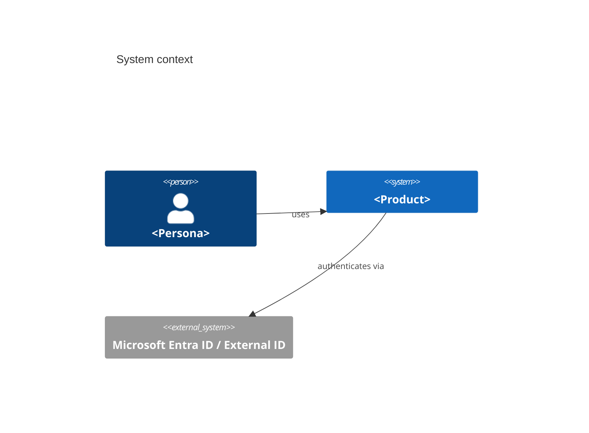
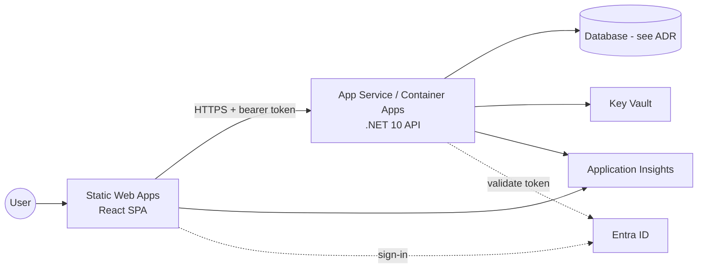
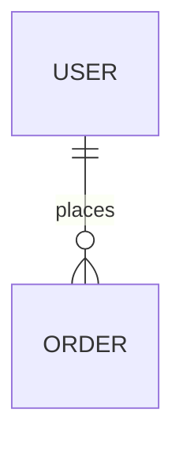

# Architecture: <Product name>

Based on PRD revision <date>. Stack profile: `dotnet-react-azure`. Decisions are recorded in `adr/`. The binding API contract is `openapi.yaml`.

## 1. Summary
<Three sentences: what runs where, the per-project choices (DB, API host, auth), and why they fit the PRD.>

## 2. Repositories
| Key | GitHub | Contents |
| --- | --- | --- |
| product | owner/<product>-product | specs, stories, contract |
| api | owner/<product>-api | .NET 10 solution, Bicep for the API |
| web | owner/<product>-web | React + TS app, Bicep for the SWA |

## 3. Context (C4 level 1)


## 4. Containers on Azure (C4 level 2)


## 5. Per-project decisions
| Decision | Choice | ADR |
| --- | --- | --- |
| Database | | 0001 |
| API hosting | App Service / Container Apps | 0002 |
| Auth | | 0003 |
| Minimal APIs vs controllers | | |
| Background work | | |

## 6. Backend design (api repo)
- Solution layout (from the stack profile, with any deviations):
```
src/<Product>.Api/Features/<Feature>/...
src/<Product>.Domain/
src/<Product>.Infrastructure/
tests/<Product>.UnitTests/  tests/<Product>.IntegrationTests/
```
- Feature slices and their responsibilities:

| Feature | Endpoints (operationIds) | Domain entities | Stories |
| --- | --- | --- | --- |

## 7. Frontend design (web repo)
| Feature folder | Screens (UI-SPEC) | operationIds used | Stories |
| --- | --- | --- | --- |
<Routing map, auth handling (MSAL React or SWA auth), error/problem+json handling pattern.>

## 8. Data model

| Entity | Key fields | EF Core notes (indexes, concurrency, owned types) |
| --- | --- | --- |

## 9. API contract
See `openapi.yaml` (binding). Conventions: resource naming, pagination (`?page=&pageSize=`, or cursor), errors = RFC 9457 `application/problem+json`, versioning strategy, and an `operationId` naming scheme.

## 10. Security
<Auth flow end to end, token audiences and scopes, roles and policies, CORS, secrets in Key Vault through managed identity, data protection and PII handling.>

## 11. Non-functional requirements: how each is met
| NFR (from the PRD) | Approach | Verified by |
| --- | --- | --- |

## 12. Environments and delivery
| Env | Web | API | Data | Deployed by |
| --- | --- | --- | --- | --- |
| PR preview | SWA preview | dev API | dev DB | web CI |
| dev | | | | push to main |
| prod | | | | manual approval (GitHub environment) |
<Bicep modules per repo, GitHub Actions OIDC federated credentials, required checks.>

## 13. Risks and mitigations
| Risk | Impact | Mitigation |
| --- | --- | --- |

## 14. Traceability
| Story | Components | operationIds | Screens |
| --- | --- | --- | --- |
