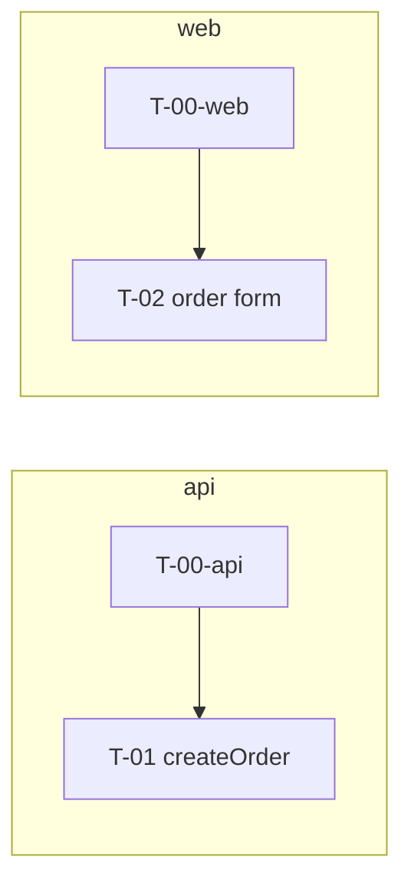

# Delivery plan: <Product name>

Based on PRD, ARCHITECTURE, openapi.yaml and UI-SPEC as approved on <dates>.

## 1. Milestones
| Milestone | Goal | Stories | Tasks |
| --- | --- | --- | --- |
| M0 Walking skeletons | Both repos build, test, and deploy to dev on Azure | — | T-00-api, T-00-web |
| M1 | | | |

## 2. Tasks
| ID | Repo | Issue | Title | Size | Implements (story · AC) | Depends on | Spec refs |
| --- | --- | --- | --- | --- | --- | --- | --- |
| T-00-api | api | owner/x-api#? | .NET 10 solution, CI, Bicep, contract test | M | — | — | ARCHITECTURE §6, §12 |
| T-00-web | web | owner/x-web#? | Vite React TS app, CI, SWA, MSW, codegen | M | — | — | ARCHITECTURE §7, UI-SPEC §2 |
| T-01 | api | | Implement `createOrder` | S | S-01 · AC1–3 | T-00-api | openapi `createOrder` |
| T-02 | web | | Create order form (SCR-02) | M | S-01 · AC1–3 | T-00-web | UI-SPEC SCR-02, openapi `createOrder` |

## 3. Build order

**Wave 1 (parallel):** T-00-api, T-00-web
**Wave 2 (parallel):** T-01, T-02 (web mocks the contract)

## 4. Definition of done (every task)
- [ ] Every claimed AC is covered by an automated test (xUnit / Vitest / Playwright)
- [ ] CI green: build, format or lint, typecheck, tests, and the contract test (api)
- [ ] Conforms to `openapi.yaml` and UI-SPEC
- [ ] PR links its issue (`Closes #N`) and the story, and has passed QA review
- [ ] A human merged it; it is deployed to dev
