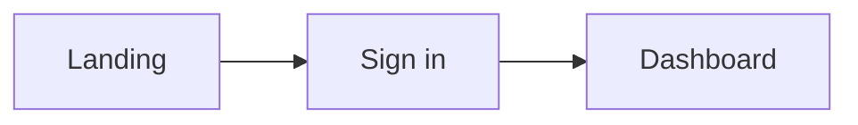

# UI specification: <Product name>

Based on PRD revision <date>.

## 1. Principles
<Three to five design principles drawn from the personas and goals.>

## 2. Design tokens
| Token | Value | Use |
| --- | --- | --- |
| `--color-primary` | | primary actions |
| `--color-surface` | | |
| `--color-text` | | |
| `--color-danger` | | errors |
| `--font-body` | | |
| `--space-1..8` | 4px scale | spacing |
| `--radius` | | |

```css
:root {
  --color-primary: ;
  /* ... */
}
```

## 3. Platforms and breakpoints
| Name | Min width | Notes |
| --- | --- | --- |

## 4. Navigation and screen inventory
| ID | Screen | Stories | Wireframe |
| --- | --- | --- | --- |
| SCR-01 | | S-01 | `wireframes/scr-01.html` |

## 5. User flows


## 6. Screens
### SCR-01 <Name>
- **Purpose:**
- **Stories / ACs:**
- **Layout regions:**
- **Components:**
- **States:** empty · loading · error · success
- **Microcopy:**

## 7. Component catalogue
| Component | Variants | States | Accessibility notes |
| --- | --- | --- | --- |
| Button | primary, secondary, danger | default, hover, focus, disabled, loading | visible focus ring; aria-busy while loading |

## 8. Accessibility
WCAG 2.2 AA: contrast, keyboard paths, focus order, reduced motion.

## 9. Open questions
- [ ]
